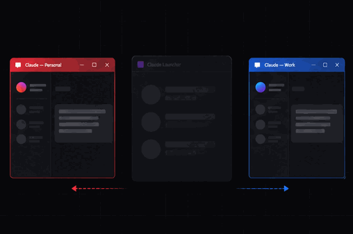

<div align="center">

# Claude Launcher

**Run multiple Claude Desktop accounts side-by-side on Windows.**

A thin UI around a Chromium CLI flag that Claude Desktop already supports. Add
an account, pick a color, launch with a keypress. Your tokens stay where Claude
Desktop put them — nothing is copied, nothing is forwarded, no telemetry.

[Install](#install) · [Why](#why) · [How it works](#how-it-works) · [FAQ](#faq) · [Contributing](#contributing)




> If Claude Launcher saves you the sign-out / sign-in dance, give it a star —
> it helps other people find it.

**Not a Claude client. Not a proxy. Not a rate-limit workaround.
Not affiliated with Anthropic — see [TRADEMARKS.md](TRADEMARKS.md).**

</div>

---

## Why

Claude Desktop stores each signed-in account in its own on-disk profile
directory. Chromium (which Electron ships on top of) honours
`--user-data-dir` and `--profile` flags that pick which directory a given
window uses. The launcher wraps that in a UI.

If one of these is you, this is for you:

| Who | What they do today | What they get here |
|---|---|---|
| **Shared Max subscriber** — you split Max 20x with a partner / roommate / team | Sign out, hand over the laptop, sign back in | Two windows, two accounts, both live |
| **Work + personal** — one Claude account for `$dayjob`, one for weekend projects | Context-switch through a browser, or juggle Chrome profiles | One click, one keypress, clean separation |
| **Claude Code power user** — different login per repo / project / client | Juggle CLI auth tokens by hand | Each profile gets its own Claude Desktop + its own CLI auth |
| **Agent / MCP tester** — need isolated accounts to compare prompts, tool outputs, model versions | Spin up a second Windows user | A new profile in 10 seconds, launcher-managed |

---

## Install

<details open>
<summary><b>Portable zip (recommended for v0.1)</b></summary>

1. Download `ClaudeLauncher-v0.1.0-win32-x64.zip` from
   [Releases](https://github.com/squashyweeb/claude-launcher/releases/latest).
2. Unzip anywhere (e.g. `C:\Tools\ClaudeLauncher\`).
3. Run `ClaudeLauncher.exe`. Windows SmartScreen will warn on first run; click
   **More info → Run anyway** (unsigned OSS; see [#1](https://github.com/squashyweeb/claude-launcher/issues) for the code-signing plan).

</details>

<details>
<summary>Run from source (Node 20+)</summary>

```bash
git clone https://github.com/squashyweeb/claude-launcher
cd claude-launcher
npm install
npm start
```

</details>

<details>
<summary>Build your own .exe</summary>

```bash
npm run pack
# Writes dist/ClaudeLauncher-win32-x64/ClaudeLauncher.exe (~210 MB with Electron runtime)
```

</details>

<details>
<summary>PowerShell + WPF fallback (no Node)</summary>

Feature-equivalent script in [legacy/launcher.ps1](legacy/launcher.ps1).
Windows PowerShell 5.1 + WPF ship with Windows — zero install cost.

```powershell
powershell -NoProfile -ExecutionPolicy Bypass -File legacy\launcher.ps1
```

</details>

**Prereqs:** Windows 10 / 11, an existing Claude Desktop install (MSIX from
the Store, or signed `.exe` installer — the launcher auto-detects and lets
you point at any `Claude.exe` if detection misses).

---

## Features

### Multiple accounts, really side-by-side

Each card launches its own Claude Desktop window with its own cookies,
IndexedDB, and auth. Both signed in. No profile copying, no sign-out dance.

### Live status for every account

Green dot = running. Shows RAM + uptime. Launch / Close / Open-folder on each
card. Click **Close** and every `claude.exe` helper process for that account
shuts down cleanly in under a second.

### Keyboard-first

Number keycap in the corner of each avatar is the key to press.

| Keys | Action |
|---|---|
| `1`-`9` | Launch account N |
| `Shift`+`1`-`9` | Close account N |
| `Ctrl`+`1`-`9` | Open account N's folder |
| `Ctrl`+`Shift`+`A` | Add new account |
| `Ctrl`+`L` / `Ctrl`+`W` | Launch all / Close all |
| `F1` | Help |
| `Esc` | Dismiss dialog, or close the launcher |

### "Who is signed in?"

Right-click any card → **Who is signed in?** decrypts the profile's OAuth
tokens locally (DPAPI + AES-GCM) and asks `api.anthropic.com/api/oauth/profile`
who the account actually belongs to. Useful when your hard-coded label and
your actual signed-in identity have drifted.

This is the only network call the launcher ever makes, triggered only by
a user action. No telemetry. No analytics. No auto-updater.

### Portable, zero-footprint

Config lives next to the launcher (`profiles.json`, `prefs.json`,
`config.json`). Delete the folder and it's gone. The launcher itself
never touches your Claude Desktop install — it just invokes it with CLI
flags.

---

## How it works

```
claude-launcher         Claude Desktop (unmodified)
    │                         │
    │  spawn("Claude.exe",    │
    │    "--user-data-dir=    │
    │     C:\…\Account-A")    │
    ├────────────────────────▶│  Chromium reads that flag,
    │                         │  loads cookies + Local State
    │                         │  from Account-A dir,
    │                         │  signs in as Account-A.
    │                         │
    │  spawn("Claude.exe",    │
    │    "--user-data-dir=    │
    │     C:\…\Account-B")    │
    ├────────────────────────▶│  Different folder, different
    │                         │  Chromium Safe Storage key,
    │                         │  different signed-in user.
    │                         │  Lives beside Account-A in
    │                         │  the OS, no collision.
```

Each account's data lives in a standard Chromium profile directory.
DPAPI seals the cookies to your Windows user. No tokens ever leave
disk. If you want the full teardown, see
[docs/02-profiles.md](docs/02-profiles.md) and
[docs/05-decrypt-tokens.md](docs/05-decrypt-tokens.md).

The optional **"New portable profile"** mode uses `--profile=NAME`, which
needs a tiny shim ([shim/profile-shim.js](shim/profile-shim.js), MIT,
50 lines, zero bytes from Anthropic) installed into your Claude Desktop
via `shim/install.ps1`. The shim redirects `userData` to
`%LOCALAPPDATA%\Claude-Data-Profiles\<name>\`. Uninstall is reversible.

---

## What still works

- **Sign-in flows** — the launcher doesn't touch cookies; Claude Desktop
  signs you in normally.
- **Claude Code CLI** — each profile dir carries its own `buddy-tokens.json`
  and CLI session.
- **MCP servers** — per-profile; one profile's MCP config doesn't bleed
  into another.
- **Updates** — Claude Desktop auto-updates per normal; the launcher
  doesn't care which version you run.
- **Uninstalling** — delete the launcher folder. Your Claude Desktop
  installs and profiles are untouched.

---

## FAQ

<details>
<summary><b>Is this allowed by Anthropic's ToS?</b></summary>

The launcher invokes `Claude.exe` with CLI flags that Chromium supports by
default. It doesn't modify Claude Desktop, doesn't share your account
across people, doesn't rotate tokens, and doesn't bypass rate limits.
Each profile signs in as itself and counts against its own quota.

That said: we are not Anthropic's lawyers. If you share a Max subscription
across more people than Anthropic's terms allow, that's between you and
them — the launcher only makes the UI less clunky.
</details>

<details>
<summary><b>Will my account get rate-limited harder?</b></summary>

Each account is signed in separately and hits its own rate limits. Running
two accounts side-by-side uses two accounts' worth of quota. The launcher
does not pool, share, or route between accounts.
</details>

<details>
<summary><b>Why Windows only?</b></summary>

That's where the author needed it. The Chromium flags work on macOS and
Linux too, and the code is ~90% portable, but the PowerShell process
query and DPAPI token-decryption are Windows-specific. See
[docs/09-roadmap.md](docs/09-roadmap.md). If you want macOS: open an
issue and say so.
</details>

<details>
<summary><b>What about SmartScreen on first run?</b></summary>

The `.exe` is unsigned (code-signing cert = $400/year). Click **More
info → Run anyway**. We've applied for a free [SignPath
Foundation](https://signpath.org/) certificate; see [#2](https://github.com/squashyweeb/claude-launcher/issues).
</details>

<details>
<summary><b>Can you add &lt;feature&gt;?</b></summary>

Short answer: open an issue. Longer answer: see
[docs/09-roadmap.md](docs/09-roadmap.md) for what's deliberately NOT
planned. Anything in the "permanent no" pile (rotation, telemetry, pooled
auth, plugin system) will stay no — those are what distinguishes a
boring utility from a liability.
</details>

<details>
<summary><b>How is this different from running two Windows user accounts?</b></summary>

Two Windows accounts works, but: you have to sign out of Windows to
switch, you can't drag windows between accounts, and each account gets
its own system state. The launcher gives you both Claude windows in
the same Windows session, same taskbar, same keyboard shortcuts.
</details>

<details>
<summary><b>Won't Chrome profiles do the same thing?</b></summary>

For the web app `claude.ai`, yes. The launcher is for the desktop app
(which has Claude Code CLI integration, better MCP support, and
notifications that Chrome profiles don't replicate).
</details>

---

## Contributing

Read [CONTRIBUTING.md](CONTRIBUTING.md). Short version:

- `good first issue` label is kept at 2-5 open, refilled as they close
- PRs get a first comment within 7 days (best-effort, solo maintainer)
- Scope stays small. The launcher is a wrapper, not a platform. Features
  that would make this a Claude client, a proxy, a rotator, or a plugin
  host are out of scope — see the "permanent no" list in
  [docs/09-roadmap.md](docs/09-roadmap.md)
- Before every push: `npm run check-pii` — scans for leaked emails,
  UUIDs, tokens, absolute paths

## Security

See [SECURITY.md](SECURITY.md). Report privately via GitHub Security
Advisories. The launcher's security model is deliberately minimal:
no tokens on disk beyond what Claude Desktop writes itself, no
network traffic except one optional profile lookup, no elevated
privileges, no auto-update.

## License

[MIT](LICENSE). Brand and trademark use: see [TRADEMARKS.md](TRADEMARKS.md).
